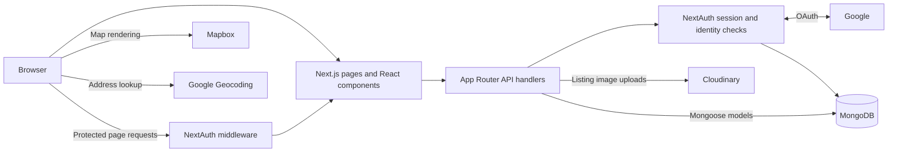

# TrustNest

**Everything local. Built on trust.**

TrustNest is a community platform in development for people in Ireland. The current application helps people find rental listings and contact listing owners. The broader vision is to bring housing, scam prevention, jobs, tradespeople, essential numbers and community services into one place.

## Contents

- [Features](#features)
- [Stack and structure](#stack-and-structure)
- [Architecture](#architecture)
- [Installation and configuration](#installation-and-configuration)
- [Using the application](#using-the-application)
- [Security](#security)
- [Testing and SAST](#testing-and-sast)
- [Roadmap](#roadmap)
- [Contributions and references](#contributions-and-references)
- [Licence and attribution](#licence-and-attribution)
- [Demonstration](#demonstration)

## Features

| Status | Features |
| --- | --- |
| Inherited, present in source | Rental browsing, featured listings, search by location and type, pagination, listing detail pages, maps, photo galleries and social sharing |
| Inherited, present in source | Google sign-in, profile and own listings, listing creation/edit/deletion, multiple image uploads, bookmarks, contact messages, inbox and unread counts |
| Added in Phase 0 | TrustNest naming, private-file ignore rules, safe sample contact data, project and security documentation, restored upstream licence |
| Planned | Ireland-specific address and pricing conventions, scam reporting and safety resources, jobs, trades directory, essential numbers and community services |

## Stack and structure

The repository is a JavaScript Next.js 14.1.0 App Router monolith with React 18. Next.js serves the UI and JSON route handlers. Tailwind CSS 3, PostCSS and Autoprefixer handle styling. NextAuth.js 4 with Google OAuth handles sign-in, Mongoose 8 and the MongoDB driver 6 support persistence, and Cloudinary 2 stores listing photos. Mapbox GL via React Map GL renders maps, Google Geocoding resolves addresses, and PhotoSwipe handles galleries. React Icons, React Share, React Spinners and React Toastify provide UI utilities. Exact dependency resolutions are in the npm lockfile.

| Path | Responsibility |
| --- | --- |
| `app/` | Home, rental catalogue and search, detail pages, listing forms, profile, saved properties and messages |
| `app/api/` | Authentication, listings, search, featured and owner listings, bookmarks, messages and unread count |
| `components/`, `context/` | Views, forms, session provider and shared client state |
| `models/` | User identity and bookmarks, Property owner and listing data, Message sender/recipient and read status |
| `config/`, `utils/` | MongoDB and Cloudinary clients, auth configuration, session lookup and API requests |
| `middleware.js` | Session checks for selected pages |
| `next.config.mjs`, `jsconfig.json`, Tailwind and PostCSS configs | Remote image hosts, path aliases and styling |
| `assets/`, `public/` | Styles, images and static assets |
| `_theme_files/`, `properties.json` | Standalone template reference files and sample listings |

## Architecture



## Installation and configuration

1. Install Node.js and npm. The inherited framework requires Node.js 18.17 or newer. Use a supported Node.js release for local evaluation and record the version used for validation.
2. Clone the repository and install the exact lockfile dependencies.

   ```sh
   git clone https://github.com/sumitbolla7/TrustNest.git
   cd TrustNest
   npm ci
   ```

3. Copy `env.example` to `.env.local`. In PowerShell use `Copy-Item env.example .env.local`, or in a POSIX shell use `cp env.example .env.local`.
4. Provision a dedicated development MongoDB database and restricted user, a development Cloudinary account or project, and a Google OAuth web client. Register `http://localhost:3000/api/auth/callback/google` on the OAuth client. Create development Mapbox and Google Geocoding credentials and restrict them as supported by the providers.
5. Fill in the local environment values. Generate a unique session secret with `node -e "console.log(require('node:crypto').randomBytes(32).toString('base64'))"`.
6. Run `npm run dev` and open `http://localhost:3000`. Keep that origin consistent with the OAuth callback and URL settings. Start with an empty catalogue and add synthetic listings through the app. The repository has no automated seed script.

| Variable | Configuration |
| --- | --- |
| `NEXT_PUBLIC_DOMAIN` | Browser-facing origin for shared listing links, normally `http://localhost:3000` |
| `NEXT_PUBLIC_API_DOMAIN` | API base URL, normally `http://localhost:3000/api` |
| `MONGODB_URI` | Private development connection string including database name |
| `GOOGLE_CLIENT_ID`, `GOOGLE_CLIENT_SECRET` | Google OAuth client ID and private client secret |
| `NEXTAUTH_URL` | Canonical application origin used by authentication and listing redirects |
| `NEXTAUTH_URL_INTERNAL` | Internal application origin when needed by NextAuth, normally the same for local use |
| `NEXTAUTH_SECRET` | Private, randomly generated session secret |
| `CLOUDINARY_CLOUD_NAME`, `CLOUDINARY_API_KEY`, `CLOUDINARY_API_SECRET` | Server-side Cloudinary account settings |
| `NEXT_PUBLIC_MAPBOX_TOKEN`, `NEXT_PUBLIC_GOOGLE_GEOCODING_API_KEY` | Browser-visible credentials. Apply minimum scope, supported origin/API restrictions, quotas and billing alerts. |

## Using the application

Browse rentals and open a listing to see its details, photos and location. Sign in with Google to save listings, send a message through a listing’s contact form or add a rental. Open Profile to edit or delete your own listings. Open Messages to see incoming messages and manage read status. Use two development accounts to exercise both sides of messaging. Use fictional addresses and contact details for local checks.

## Security

Phase 0 reviewed source and repository hygiene. Runtime hardening and security verification are pending. See the [security policy](SECURITY.md) for private reporting and development boundaries.

| Security requirement | Phase 0 status | Evidence or next step |
| --- | --- | --- |
| Repository secret hygiene | Added and checked | Ignore rules and placeholder environment template; pattern scans have limited coverage |
| Authentication | Inherited, static review | Google OAuth and MongoDB user lookup; verify sign-in and failure handling |
| Session management | Inherited, static review | NextAuth default JWT-backed session without an adapter; verify cookie attributes, expiry and sign-out |
| Authorization | Partial | Middleware covers add, profile, saved and messages pages; APIs check listing ownership on edits/deletes and message recipient on inbox changes |
| Patched framework | Open | Next.js 14.1.0 falls in the affected range of CVE-2025-29927; upgrade and verify against current advisories |
| Input validation and injection prevention | Partial | Mongoose types and required fields exist; add explicit schemas, ObjectId checks, bounded pagination and literal search handling |
| Upload and abuse controls | Open | Add server-side file count, size and type validation, quotas, rate limits and cleanup after failed uploads |
| Privacy and data minimisation | Open | Public listing handlers return full listing documents including seller contact fields; define public projections and verify exposure |
| Automated SAST and functional checks | Pending | Configure tooling and record results against exact commits |

Google sign-in currently finds or creates the user by email. The session callback uses the email to look up the MongoDB user ID. For the next phase, verify handling for missing identities, stable provider identifiers, token expiry, cookie settings and revocation requirements. Enforce authorization at every protected data boundary, including direct requests to route handlers. Confirm origin and CSRF protections for custom state-changing endpoints.

Search currently builds regular expressions from request inputs. Bound input lengths and pagination, validate types and ranges before querying, and treat search terms as literals. Build queries from explicit allowlisted fields, avoid passing client-authored filters into MongoDB and validate updates independently of form controls. Derive the message recipient from the listing on the server and add spam prevention. Replace verbose server error logging with redacted diagnostics. Keep credentials outside Git and use least-privilege service accounts.

## Testing and SAST

Use a dedicated development database and synthetic records. Record each check, expected outcome, actual outcome, environment and commit hash.

- Smoke-test the home page, browsing, search, pagination, details, images, maps and absent listings.
- Verify Google sign-in and sign-out, protected pages when signed out, bookmark isolation, and listing and inbox operations with two different users.
- Verify rejection of malformed IDs, invalid fields and files outside upload policy after implementing validation. Check that public responses contain only intended fields.
- Review changes with `git diff --check`, inspect staged files, run a secret scan and validate package and fixture JSON before committing.
- Run a dependency audit with `npm audit` once the registry is available. Review the lockfile and vendor advisories. Dependency auditing complements SAST.
- Add a JavaScript SAST run with CodeQL or equivalent, then review findings for authorization, injection, secret handling and unsafe uploads. Configure a noninteractive lint baseline. The inherited `npm run lint` invokes `next lint`, and the repository currently has no ESLint configuration or automated test script.
- Run `npm run build` with isolated development configuration once dependencies and services are ready. Phase 0 records static inspection and repository validation only.

## Roadmap

1. **Phase 0** — Establish repository, provenance, documentation and security baseline.
2. **Phase 1, pending approval** — Validate local workflows, patch dependencies, add security tests, and address access control, data exposure, validation and upload limits.
3. **Later phases** — Localise housing for Ireland, add scam prevention and moderation, and build the jobs, trades, essential numbers and community services modules.

## Contributions and references

Repository maintainer on GitHub is `sumitbolla7`. Use focused changes, inspect diffs and staged contents for secrets, validate behavior and update the documentation where relevant. Write descriptive commits and use ordinary pushes. Report vulnerabilities privately through the process in [SECURITY.md](SECURITY.md).

- [TrustNest commit history](https://github.com/sumitbolla7/TrustNest/commits/main/)
- [Next.js framework security advisory for CVE-2025-29927](https://github.com/vercel/next.js/security/advisories/GHSA-f82v-jwr5-mffw)
- [Property Pulse upstream project](https://github.com/bradtraversy/property-pulse)
- [Brad Traversy’s Next 14 From Scratch course](https://www.traversymedia.com/nextjs-from-scratch)

## Licence and attribution

TrustNest builds on **Property Pulse** by **Brad Traversy / Traversy Media**. The upstream MIT copyright and permission notice is preserved in [LICENSE.md](LICENSE.md). Dependencies retain their own licences. The provenance and redistribution terms of individual bundled media assets should be verified before public distribution of the application.

## Demonstration

A TrustNest demonstration video will be linked here after the local workflows have been validated.
