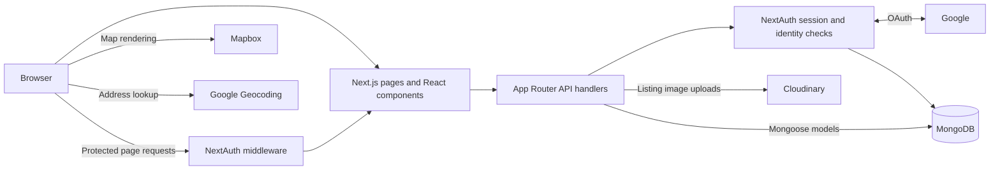
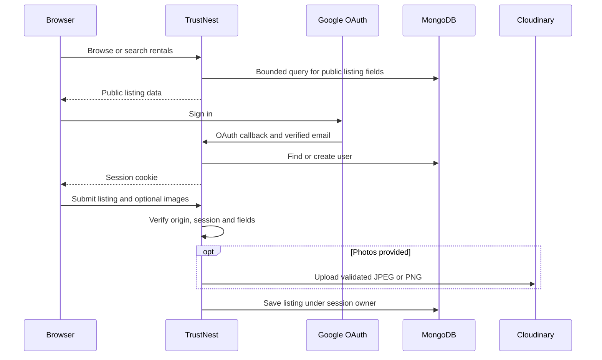

# TrustNest

**Everything local. Built on trust.**

National College of Ireland (NCI) · Secure Web Development

TrustNest is a community platform in development for people in Ireland. The current application helps people find rental listings and contact listing owners. The broader vision is to bring housing, scam prevention, jobs, tradespeople, essential numbers and community services into one place.

## Contents

- [Features](#features)
- [Phase 5 — Full-stack rental workflows](#phase-5--full-stack-rental-workflows)
- [Stack and structure](#stack-and-structure)
- [Architecture](#architecture)
- [Installation and configuration](#installation-and-configuration)
- [Database seeding](#database-seeding)
- [Temporary hosting](#temporary-hosting)
- [Using the application](#using-the-application)
- [Security](#security)
- [Testing and SAST](#testing-and-sast)
- [Roadmap](#roadmap)
- [Contributions and references](#contributions-and-references)
- [Licence and attribution](#licence-and-attribution)
- [Demonstration](#demonstration)

## Features

| Status | Features |
| --- | --- |
| Inherited, present in source | Rental browsing, featured listings, search by location and type, pagination, listing detail pages, maps, photo galleries and social sharing |
| Inherited, present in source | Google sign-in, profile and own listings, listing creation/edit/deletion, multiple image uploads, bookmarks, contact messages, inbox and unread counts |
| Added in Phase 0 | TrustNest naming, private-file ignore rules, safe sample contact data, project and security documentation, restored upstream licence |
| Added in Phase 1 | Original TrustNest SVG, Irish address fields and Eircodes, EUR rents, metric floor area, fictional sample rentals and a community services preview |
| Added in Phase 3 | Irish marketplace with 26 counties, combined filters, pagination, rental details and safety guidance, personal saved rentals and 30 fictional fixtures |
| Added in Phase 5 | Role dashboards, listing approval, landlord verification, enquiries, conversations, viewing requests, reports and notifications |
| Planned | Jobs, trades directory, essential numbers, businesses and community services |

## Phase 5 — Full-stack rental workflows

The latest prior handoff was Phase 3. The repository contains no Phase 4 completion record. Phase 5 adds the landlord and reporting workflows as part of the complete locally tested rental flow.

| Role | Access |
| --- | --- |
| Tenant | Public registration. Browse and save rentals, enquire, request viewings, submit reports, and manage notification settings. |
| Landlord | Public landlord registration. Create drafts, request approval, manage owned listings, request platform verification, respond to enquiries and review viewings. |
| Administrator | Provisioning outside registration. Review users, listings, verification and reports. Administrative actions create audit records. |

### Local database and demonstration accounts

Install with `npm ci`. For a connected local demo, configure `MONGODB_URI` for a dedicated development database, `NEXTAUTH_URL=http://localhost:3000` and a private random `NEXTAUTH_SECRET`. Then run:

```sh
npm run dev -- --hostname 127.0.0.1 --port 3000
```

Visit `http://localhost:3000`. With account and database settings blank, the site serves the provider-free sample catalogue. With the database configured, the catalogue retrieves MongoDB records. Use the guarded property seed below for 30 fictional rentals.

Tenants and landlords can register in the browser. For a fictional administrator, set `TRUSTNEST_DEMO_MONGODB_URI`, `TRUSTNEST_DEMO_DATABASE`, `TRUSTNEST_BOOTSTRAP_EMAIL` and `TRUSTNEST_BOOTSTRAP_PASSWORD` in your local shell. Choose a dedicated database named `trustnest_demo` or `trustnest_demo_SUFFIX` and a password of at least 12 characters. Run `npm run seed:account -- admin --confirm-demo` and clear the bootstrap password from the shell. The same command accepts `tenant` or `landlord`. The script creates a new user and refuses an existing email. Existing Google accounts without an assigned role default to tenant and retain their listing ownership.

### Provider configuration and limitations

- For email delivery, set `RESEND_API_KEY` and `TRUSTNEST_EMAIL_FROM` to a verified Resend sender. Use `TRUSTNEST_REQUIRE_VERIFIED_EMAIL=true` with configured mail before exposing credential registration externally. Leave it false for the isolated mail-free demo.
- Set `GOOGLE_CLIENT_ID` and `GOOGLE_CLIENT_SECRET` only when enabling optional Google OAuth. Register the exact application origin plus `/api/auth/callback/google`.
- Set the three `CLOUDINARY_*` values only when enabling managed photo uploads. The form previews and removes local selections, and the API decodes and re-encodes uploads before sending them to storage.
- Set `TRUSTNEST_SUPPORT_EMAIL` to show a support address on the contact page.
- Account deletion redacts credentials and profile identity, disables sessions and removes owned listings from public results. Previous conversations and administrative records may remain. The draft policies need review before commercial use.
- The original inbox remains available from the dashboards. Workspaces display recent records. Hosted cookie behaviour and external provider delivery require separate validation.

### Phase 5 verification

Lint, a production build, 13 unit tests, provider-free HTTP smoke, and both MongoDB integration suites passed. `npm run test:phase5` exercises real NextAuth credential registration and login, session revocation, listing approval, verified search, bookmarks, account isolation, messages, viewing transitions, reports, notifications and administrative audit. Set `TRUSTNEST_TEST_MONGO` to a dedicated loopback MongoDB daemon as described in the testing section and build before running it.

GitHub application checks passed on `c2f65f1`. The existing Semgrep and Gitleaks jobs passed. The production-only dependency audit passed, while the full dependency check still reports the three moderate development advisories listed below.

Microsoft Edge checks at 390, 820, 1280 and 1366 pixels covered account flows, dashboards, listing photo preview/removal and administrator approval. Account token consumption was verified with synthetic single-use tokens. Outbound Resend email, live Google OAuth, Cloudinary delivery and protected Vercel HTTPS were outside the local verification. Formal testing remains scheduled for a later phase.

## Stack and structure

TrustNest uses Next.js 16.4.6 and React 19.3.1 with the App Router to keep React pages and HTTP handlers in one application. Tailwind CSS gives the rental and community pages a shared design system. MongoDB stores listings, messages and users, with Mongoose 8.24.11 providing schemas and explicit queries. NextAuth.js 4.24.15 manages credential sessions and supports optional Google sign-in. Cloudinary optionally stores validated listing photos, with PhotoSwipe for gallery navigation. Mapbox GL and Google Geocoding add optional map previews. Exact dependency versions and platform-specific packages are in the npm lockfile.

| Path | Responsibility |
| --- | --- |
| `app/` | Home, rental catalogue and search, detail pages, listing forms, profile, saved properties and messages |
| `app/api/` | Authentication, listings, search, featured and owner listings, bookmarks, messages and unread count |
| `components/`, `context/` | Views, forms, session provider and shared client state |
| `models/` | Users, saved rentals, properties, legacy inbox, conversations, thread messages, viewing requests, verification, reports, notifications and moderation audit |
| `app/dashboard/`, `app/account/` | Role workspaces, credential sign-in and registration |
| `app/info/` | Help, contact, safety, FAQ, privacy and terms |
| `config/`, `utils/` | MongoDB and Cloudinary clients, auth configuration, session lookup and API requests |
| `proxy.js` | Session checks for selected pages |
| `next.config.mjs`, `jsconfig.json`, Tailwind and PostCSS configs | Remote image hosts, path aliases and styling |
| `assets/`, `public/` | Styles, images and static assets |
| `_theme_files/`, `properties.json` | Archived reference templates and the earlier five-item coursework fixture |
| `config/demoListings.mjs`, `public/rentals/` | Current 30 fictional rentals and original illustration assets |
| `docs/hosting.md`, `vercel.json` | Protected preview setup, deployment diagram and manual deployment configuration |
| `app/community/`, `config/community.js` | Community module preview and service labels |
| `tests/`, `scripts/`, `.github/workflows/` | Unit and HTTP checks, environment and secret checks, CI and security automation |

## Architecture





## Installation and configuration

1. Install Node.js 24 and npm. The package supports Node.js 22 or later, and CI uses Node.js 24.
2. Clone the repository and install the exact lockfile dependencies.

   ```sh
   git clone https://github.com/sumitbolla7/TrustNest.git
   cd TrustNest
   npm ci
   ```

3. Copy `.env.example` to `.env.local`. In PowerShell use `Copy-Item .env.example .env.local`, or in a POSIX shell use `cp .env.example .env.local`.
4. For a provider-free preview, leave account and database settings blank. For the connected app, configure a dedicated MongoDB database, `NEXTAUTH_URL` and `NEXTAUTH_SECRET`. Configure Google OAuth, managed photos, email or maps only if needed.
5. Fill in the local environment values and run `npm run check:env -- --full`. Generate a unique session secret with `node -e "console.log(require('node:crypto').randomBytes(32).toString('base64'))"`.
6. Run `npm run dev -- --hostname 127.0.0.1 --port 3000` and open `http://localhost:3000` or `http://127.0.0.1:3000`. Keep the browser hostname consistent with the OAuth callback and canonical origin.

| Variable | Configuration |
| --- | --- |
| `NEXT_PUBLIC_DOMAIN` | Browser-facing origin for shared listing links, normally `http://localhost:3000` |
| `NEXT_PUBLIC_API_DOMAIN` | API base URL, normally `http://localhost:3000/api` |
| `MONGODB_URI` | Private development connection string including database name |
| `GOOGLE_CLIENT_ID`, `GOOGLE_CLIENT_SECRET` | Google OAuth client ID and private client secret |
| `NEXTAUTH_URL` | Canonical application origin used by authentication and listing redirects |
| `NEXTAUTH_URL_INTERNAL` | Internal application origin when needed by NextAuth, normally the same for local use |
| `NEXTAUTH_SECRET` | Private, randomly generated session secret |
| `CLOUDINARY_CLOUD_NAME`, `CLOUDINARY_API_KEY`, `CLOUDINARY_API_SECRET` | Server-side Cloudinary account settings |
| `NEXT_PUBLIC_MAPBOX_TOKEN`, `NEXT_PUBLIC_GOOGLE_GEOCODING_API_KEY` | Browser-visible credentials. Apply minimum scope, supported origin/API restrictions, quotas and billing alerts. |

## Database seeding

The provider-free catalogue uses the fictional fixture in memory. To load the same 30 sample rentals into MongoDB, use a dedicated database named `trustnest_demo` or `trustnest_demo_SUFFIX` with a lowercase alphanumeric suffix. Configure `TRUSTNEST_DEMO_MONGODB_URI` and `TRUSTNEST_DEMO_DATABASE` locally and run `npm run seed:demo -- --confirm-demo`. Point `MONGODB_URI` at that database for the database-backed preview. The seeder upserts only its own labelled fixtures with stable IDs and creates the sparse unique demo key index. It does not reset the database or create a landlord account.

## Temporary hosting

See [Protected Vercel preview](docs/hosting.md) for account linking, runtime configuration, the deployment diagram, verification and rollback. No preview URL has been issued. Automatic Git deployments are disabled.

## Using the application

Open **Sample rentals** for demonstrations in Dublin, Cork, Galway, Limerick and Waterford. Filter by county and town, monthly rent, property type, bedrooms, bathrooms, furnishing, move-in date and amenities. Use the student or shared accommodation choices to narrow the results. Listing details expose approximate locations. Sample listings cannot receive enquiries. Sign in with Google to save listings, send a message through a listing’s contact form or add a rental. Open Profile to edit or delete your own listings. Open Messages to see incoming messages and manage read status. Use two development accounts to exercise both sides of messaging. The report form creates a private moderation item. The safety guide also links to Garda reporting information. Use fictional addresses and contact details for local checks.

## Security

Phase 5 adds database-backed role checks and session invalidation on password changes and account suspension. Moderator decisions, verification data and reports stay inside authenticated workspaces. The legacy security table below records controls introduced in earlier phases.

| Requirement ID | Description | Implementation | Status | Test Case | Evidence |
| --- | --- | --- | --- | --- | --- |
| SEC-01 | Authentication and secure credential handling | Inherited Google OAuth. Added verified email check and local placeholder configuration | Partial | TN-06, OAuth sign-in and denial | Environment test and `utils/authOptions.js`. Provider integration pending. |
| SEC-02 | Server-side authorization and resource ownership | Inherited listing owner and message recipient checks. Added owner-only listing management queries and removed seller contact fields from public results | Partial | TN-08, two-account access checks | HTTP smoke and property API review. Two-account tests pending. |
| SEC-03 | Secure session and cookie management | NextAuth JWT sessions, explicit 24-hour maximum age and NextAuth cookie defaults | Partial | Two-account expiry and sign-out | `utils/authOptions.js`. HTTPS cookie and revocation validation pending. |
| SEC-04 | Input validation and injection prevention | Literal search, query bounds, listing/message validation, ObjectId validation and JPEG/PNG upload limits | Implemented for covered routes | TN-01, TN-03, TN-05, TN-08 | Unit and HTTP tests, property and message handlers |
| SEC-05 | Secure configuration, secret management and error handling | Environment checks, staged and history scans, same-origin writes, response headers and generic API errors | Partial | TN-04, TN-06, TN-08 | Automated checks passed. HTTPS deployment and full CSP are pending. |
| SEC-06 | Protect private rental and tenant data | Public projection omits exact addresses and owner identity. Authenticated writes derive ownership from the session. | Verified locally | Two-session MongoDB integration | Saved rentals, listing changes and enquiries tested with distinct accounts. |
| SEC-07 | Limit abuse and validate uploaded images | MongoDB write counters, decoded and re-encoded photos, size bounds and random Cloudinary IDs | Partial | MongoDB throttling and photo decoder tests | Local controls passed. Cloudinary round trip and anonymous read limits remain open. |

Phase 0 removed an inherited hardcoded Mapbox secret from the standalone property template after GitHub push protection blocked the unpublished commit. Phase 1 rechecked tracked files and the archived template only accepts externally provided public tokens. The application reads its own restricted public map token from `NEXT_PUBLIC_MAPBOX_TOKEN`. The original token's revocation status is unknown.

NextAuth handles its own OAuth and CSRF controls. Custom write routes enforce the configured origin. React escapes rendered text by default. The security headers prevent framing and MIME sniffing, and restrict selected browser permissions. The content security policy covers framing, embedded objects and base URLs. Work remains for script policy, anonymous read limits, reliable asset cleanup, privacy retention and monitoring. If migrating inherited data, confirm the original currency before making it available as Irish rental data. The app displays stored rent values as EUR and converts legacy square feet for display. Phase 3 adds explicit public response fields, owner-scoped mutations, authenticated write limits backed by MongoDB, schema-based browse filters, decoded and re-encoded image uploads and browser-safe rendering of listing text.

## Testing and SAST

- Run `npm run lint`, `npm test`, `npm run build`, and `npm run test:smoke`. Unit checks cover Irish formatting and validation, literal search, origin checks, image signatures, environment validation and fixtures. The production smoke test starts a loopback server with providers disabled and checks key pages, API status codes, headers and session fallback.
- With isolated services, test OAuth sign-in/sign-out, listing ownership with two users, image uploads, bookmark isolation, inbox and map geocoding. Record account roles, outcomes and exact commit. No provider-backed results are recorded for Phase 1.
- CI runs lint, unit and HTTP checks, environment validation, a build and targeted secret scanning. The separate security workflow runs npm dependency auditing, Semgrep JavaScript/OWASP rules and Gitleaks on Git history. Review findings before applying changes. It runs on pushes to main, pull requests, manual dispatch and daily at 20:00 Europe/Dublin.
- [Application workflow](https://github.com/sumitbolla7/TrustNest/actions/workflows/ci.yml)
- [Security workflow](https://github.com/sumitbolla7/TrustNest/actions/workflows/security.yml)

### Phase 3 results

| Check | Phase 3 evidence |
| --- | --- |
| Local install and build | Node.js 24.16.0 and npm 11.13.0. `npm ci`, lint, environment validation, production build and provider-free HTTP smoke passed. |
| Unit tests | 13 passed, including invalid filters, NoSQL-shaped input, date and enum validation, fixture isolation and photo decoding. |
| MongoDB integration | On a dedicated loopback MongoDB 8.0.16 instance, the first seed inserted 30 and the second inserted zero. Two signed synthetic sessions verified bookmark isolation, owner-only changes, escaped listing text, enquiry isolation and HTTP 429 throttling. |
| Responsive browser checks | Microsoft Edge through Playwright at 390px and 1366px verified home, mobile navigation, county search, rental details and gallery. |
| Hosted checks | On `e99385e`, app CI passed, Semgrep ran 102 rules on 112 files with zero findings and Gitleaks found no leaks. [Application checks](https://github.com/sumitbolla7/TrustNest/actions/runs/45850350460) · [Security checks](https://github.com/sumitbolla7/TrustNest/actions/runs/45850350353) |
| Dependencies | Production-only npm audit reported zero advisories. The full audit reports three moderate development advisories in glob, minimatch and sucrase. |

To reproduce the database checks, build once and set `TRUSTNEST_TEST_MONGO` to the URI for a dedicated loopback MongoDB instance, such as `mongodb://127.0.0.1:37171` with no database path. Run `npm run test:db`. The test writes only to a uniquely named synthetic test database on that daemon. It exercises the session mechanism with ephemeral signed test cookies. Real Google OAuth registration and login, HTTPS cookies, hosted access protection and Cloudinary delivery require configured providers.

### Phase 1 recorded results

| Check | Phase 1 local result |
| --- | --- |
| Reproducible install | `npm ci` passed with Node.js 24.16.0 and npm 11.13.0. Local development served the fictional rentals page at `http://127.0.0.1:3000`. |
| Application checks | Lint, eight unit tests, preview environment validation, production build and provider-free HTTP smoke passed |
| npm audit | Three moderate development-only findings in glob, minimatch and sucrase. Production-only audit reported zero findings. |
| Workflows | Both workflows passed actionlint. On the final application changes at `eb3b61b`, GitHub application checks, Semgrep, Gitleaks and the production dependency audit passed. The full dependency audit flagged three moderate development-only findings. [Application checks](https://github.com/sumitbolla7/TrustNest/actions/runs/45704611666) · [Security checks](https://github.com/sumitbolla7/TrustNest/actions/runs/45704611527) |

## Roadmap

1. **Phase 0** — Establish repository, provenance, documentation and security baseline.
2. **Phase 1** — Establish Irish housing UX, provider-free checks, foundational controls and security automation.
3. **Phase 2, no completion record** — Verify provider-backed workflows, strengthen authorisation and session handling, and add abuse prevention. Phase 3 addressed marketplace blockers and left provider-backed sign-in and hosted HTTPS pending.
4. **Phase 3** — Irish rental marketplace and protected preview preparation.
5. **Phase 4, no completion record** — Its landlord and scam report workflows were implemented during Phase 5.
6. **Phase 5** — Full-stack rental workflows and local functional verification.
7. **Phase 6, pending approval** — External integration setup and additional approved work.

## Contributions and references

Student maintainer `sumitbolla7` directs the TrustNest branding, Irish rental adaptation, marketplace and security requirements, checks and academic documentation. Phase 5 adds authenticated rental workflows, role management, moderation and functional tests on top of the inherited foundation credited below. Use focused changes, inspect diffs and staged contents for secrets, validate behavior and update the documentation where relevant. Write descriptive commits and use ordinary pushes. Report vulnerabilities privately through the process in [SECURITY.md](SECURITY.md).

- [TrustNest commit history](https://github.com/sumitbolla7/TrustNest/commits/main/)
- [1] Vercel, “Next.js security advisory for CVE-2025-29927.” [Online]. Available at [advisory](https://github.com/vercel/next.js/security/advisories/GHSA-f82v-jwr5-mffw)
- [2] B. Traversy, “Property Pulse.” [Online]. Available at [source repository](https://github.com/bradtraversy/property-pulse)
- [3] B. Traversy, “Next 14 From Scratch.” [Online]. Available at [course](https://www.traversymedia.com/nextjs-from-scratch)

- [4] An Garda Síochána, “Fraud.” [Online]. Available at [official reporting guidance](https://www.garda.ie/en/crime/fraud/).
- [5] Vercel, “Deployment Protection.” [Online]. Available at [Vercel Documentation](https://vercel.com/docs/deployment-protection).

## Licence and attribution

TrustNest builds on **Property Pulse** by **Brad Traversy / Traversy Media**. The upstream MIT copyright and permission notice is preserved in [LICENSE.md](LICENSE.md). Dependencies retain their own licences. The provenance and redistribution terms of individual bundled media assets should be verified before public distribution of the application.

## Demonstration

A TrustNest demonstration video will be linked here after the local workflows have been validated.
