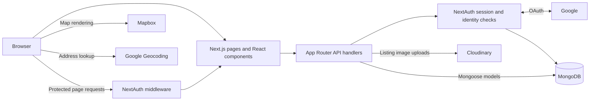
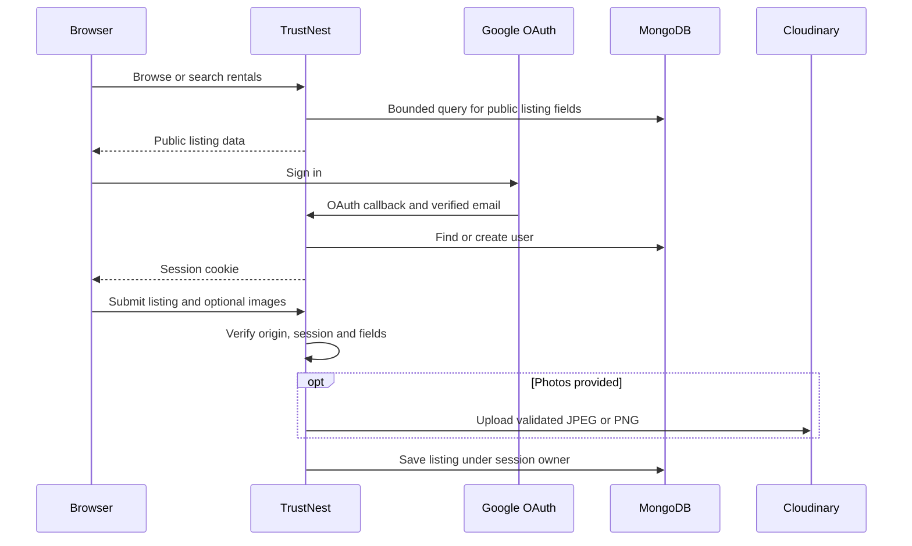

# TrustNest

**Everything local. Built on trust.**

TrustNest is a community platform in development for people in Ireland. The current application helps people find rental listings and contact listing owners. The broader vision is to bring housing, scam prevention, jobs, tradespeople, essential numbers and community services into one place.

## Contents

- [Features](#features)
- [Stack and structure](#stack-and-structure)
- [Architecture](#architecture)
- [Installation and configuration](#installation-and-configuration)
- [Using the application](#using-the-application)
- [Security](#security)
- [Testing and SAST](#testing-and-sast)
- [Roadmap](#roadmap)
- [Contributions and references](#contributions-and-references)
- [Licence and attribution](#licence-and-attribution)
- [Demonstration](#demonstration)

## Features

| Status | Features |
| --- | --- |
| Inherited, present in source | Rental browsing, featured listings, search by location and type, pagination, listing detail pages, maps, photo galleries and social sharing |
| Inherited, present in source | Google sign-in, profile and own listings, listing creation/edit/deletion, multiple image uploads, bookmarks, contact messages, inbox and unread counts |
| Added in Phase 0 | TrustNest naming, private-file ignore rules, safe sample contact data, project and security documentation, restored upstream licence |
| Added in Phase 1 | Original TrustNest SVG, Irish address fields and Eircodes, EUR rents, metric floor area, fictional sample rentals and a community services preview |
| Planned | Scam reporting and safety resources, jobs, trades directory, essential numbers and community services |

## Stack and structure

TrustNest uses Next.js 16.4.6 and React 19.3.1 with the App Router to keep React pages and HTTP handlers in one application. Tailwind CSS gives the rental and community pages a shared design system. MongoDB stores listings, messages and users, with Mongoose 8.24.11 providing schemas and explicit queries. NextAuth.js 4.24.15 delegates sign-in to Google. Cloudinary stores uploaded listing photos, with PhotoSwipe for gallery navigation. Mapbox GL and Google Geocoding add optional map previews. Exact dependency versions and platform-specific packages are in the npm lockfile.

| Path | Responsibility |
| --- | --- |
| `app/` | Home, rental catalogue and search, detail pages, listing forms, profile, saved properties and messages |
| `app/api/` | Authentication, listings, search, featured and owner listings, bookmarks, messages and unread count |
| `components/`, `context/` | Views, forms, session provider and shared client state |
| `models/` | User identity and bookmarks, Property owner and listing data, Message sender/recipient and read status |
| `config/`, `utils/` | MongoDB and Cloudinary clients, auth configuration, session lookup and API requests |
| `proxy.js` | Session checks for selected pages |
| `next.config.mjs`, `jsconfig.json`, Tailwind and PostCSS configs | Remote image hosts, path aliases and styling |
| `assets/`, `public/` | Styles, images and static assets |
| `_theme_files/`, `properties.json` | Archived reference templates and fictional Irish listings |
| `app/community/`, `config/community.js` | Community module preview and service labels |
| `tests/`, `scripts/`, `.github/workflows/` | Unit and HTTP checks, environment and secret checks, CI and security automation |

## Architecture





## Installation and configuration

1. Install Node.js 24 and npm. The package supports Node.js 22 or later, and CI uses Node.js 24.
2. Clone the repository and install the exact lockfile dependencies.

   ```sh
   git clone https://github.com/sumitbolla7/TrustNest.git
   cd TrustNest
   npm ci
   ```

3. Copy `.env.example` to `.env.local`. In PowerShell use `Copy-Item .env.example .env.local`, or in a POSIX shell use `cp .env.example .env.local`.
4. For a provider-free preview, leave the credential fields blank and skip to step 6. Open `/properties/demo` for fictional sample rentals. For full development, provision a dedicated development MongoDB database and restricted user, a development Cloudinary account or project, and a Google OAuth web client. Register `http://localhost:3000/api/auth/callback/google` on the OAuth client. Create development Mapbox and Google Geocoding credentials and restrict them as supported by the providers.
5. Fill in the local environment values and run `npm run check:env -- --full`. Generate a unique session secret with `node -e "console.log(require('node:crypto').randomBytes(32).toString('base64'))"`.
6. Run `npm run dev` and open `http://localhost:3000`. Keep that origin consistent with the OAuth callback and URL settings. Start with an empty catalogue and add synthetic listings through the app. The sample page reads `properties.json` directly and stores nothing in MongoDB. The live catalogue stays empty until you create listings in the development database.

| Variable | Configuration |
| --- | --- |
| `NEXT_PUBLIC_DOMAIN` | Browser-facing origin for shared listing links, normally `http://localhost:3000` |
| `NEXT_PUBLIC_API_DOMAIN` | API base URL, normally `http://localhost:3000/api` |
| `MONGODB_URI` | Private development connection string including database name |
| `GOOGLE_CLIENT_ID`, `GOOGLE_CLIENT_SECRET` | Google OAuth client ID and private client secret |
| `NEXTAUTH_URL` | Canonical application origin used by authentication and listing redirects |
| `NEXTAUTH_URL_INTERNAL` | Internal application origin when needed by NextAuth, normally the same for local use |
| `NEXTAUTH_SECRET` | Private, randomly generated session secret |
| `CLOUDINARY_CLOUD_NAME`, `CLOUDINARY_API_KEY`, `CLOUDINARY_API_SECRET` | Server-side Cloudinary account settings |
| `NEXT_PUBLIC_MAPBOX_TOKEN`, `NEXT_PUBLIC_GOOGLE_GEOCODING_API_KEY` | Browser-visible credentials. Apply minimum scope, supported origin/API restrictions, quotas and billing alerts. |

## Using the application

Open **Sample rentals** for demonstrations in Dublin, Cork, Galway, Limerick and Waterford. Browse the live catalogue and open a listing to see its details, photos and location. Sign in with Google to save listings, send a message through a listing’s contact form or add a rental. Open Profile to edit or delete your own listings. Open Messages to see incoming messages and manage read status. Use two development accounts to exercise both sides of messaging. Use fictional addresses and contact details for local checks.

## Security

| Requirement ID | Description | Implementation | Status | Test Case | Evidence |
| --- | --- | --- | --- | --- | --- |
| SEC-01 | Authentication and secure credential handling | Inherited Google OAuth. Added verified email check and local placeholder configuration | Partial | TN-06, OAuth sign-in and denial | Environment test and `utils/authOptions.js`. Provider integration pending. |
| SEC-02 | Server-side authorization and resource ownership | Inherited listing owner and message recipient checks. Added owner-only listing management queries and removed seller contact fields from public results | Partial | TN-08, two-account access checks | HTTP smoke and property API review. Two-account tests pending. |
| SEC-03 | Secure session and cookie management | NextAuth JWT sessions, explicit 24-hour maximum age and NextAuth cookie defaults | Partial | Two-account expiry and sign-out | `utils/authOptions.js`. HTTPS cookie and revocation validation pending. |
| SEC-04 | Input validation and injection prevention | Literal search, query bounds, listing/message validation, ObjectId validation and JPEG/PNG upload limits | Implemented for covered routes | TN-01, TN-03, TN-05, TN-08 | Unit and HTTP tests, property and message handlers |
| SEC-05 | Secure configuration, secret management and error handling | Environment validation, credential exclusions and scans, restricted origin on mutations, response headers and generic API failures | Partial | TN-04, TN-06, TN-08 | Environment, origin, smoke and staged scan; rate limiting and full CSP still open. |

Phase 0 removed an inherited hardcoded Mapbox secret from the standalone property template after GitHub push protection blocked the unpublished commit. Phase 1 rechecked tracked files and the archived template only accepts externally provided public tokens. The application reads its own restricted public map token from `NEXT_PUBLIC_MAPBOX_TOKEN`. The original token's revocation status is unknown.

NextAuth handles its own OAuth and CSRF controls. Custom write routes enforce the configured origin. React escapes rendered text by default. The security headers prevent framing and MIME sniffing, and restrict selected browser permissions. The content security policy covers framing, embedded objects and base URLs. Runtime work remains for script policy, rate limits, upload rollback, privacy retention and monitoring. If migrating inherited data, confirm the original currency before making it available as Irish rental data. The app displays stored rent values as EUR and converts legacy square feet for display.

## Testing and SAST

- Run `npm run lint`, `npm test`, `npm run build`, and `npm run test:smoke`. Unit checks cover Irish formatting and validation, literal search, origin checks, image signatures, environment validation and fixtures. The production smoke test starts a loopback server with providers disabled and checks key pages, API status codes, headers and session fallback.
- With isolated services, test OAuth sign-in/sign-out, listing ownership with two users, image uploads, bookmark isolation, inbox and map geocoding. Record account roles, outcomes and exact commit. No provider-backed results are recorded for Phase 1.
- CI runs lint, unit and HTTP checks, environment validation, a build and targeted secret scanning. The separate security workflow runs npm dependency auditing, Semgrep JavaScript/OWASP rules and Gitleaks on Git history. Review findings before applying changes. It runs on pushes to main, pull requests, manual dispatch and daily at 20:00 Europe/Dublin.
- [Application workflow](https://github.com/sumitbolla7/TrustNest/actions/workflows/ci.yml)
- [Security workflow](https://github.com/sumitbolla7/TrustNest/actions/workflows/security.yml)

### Recorded results

| Check | Phase 1 local result |
| --- | --- |
| Reproducible install | `npm ci` passed with Node.js 24.16.0 and npm 11.13.0. Local development served the fictional rentals page at `http://127.0.0.1:3000`. |
| Application checks | Lint, eight unit tests, preview environment validation, production build and provider-free HTTP smoke passed |
| npm audit | Three moderate development-only findings in glob, minimatch and sucrase. Production-only audit reported zero findings. |
| Workflows | Both workflows passed actionlint. The first hosted application and Git history secret checks passed. Semgrep flagged six mutable action references, which were subsequently pinned to commit SHAs. The full audit flags three moderate development-only findings. |

## Roadmap

1. **Phase 0** — Establish repository, provenance, documentation and security baseline.
2. **Phase 1** — Establish Irish housing UX, provider-free checks, foundational controls and security automation.
3. **Phase 2, pending approval** — Verify provider-backed workflows, strengthen authorisation and session handling, and add abuse prevention. Later phases will add scam prevention and moderation, and build the jobs, trades, essential numbers and community services modules.

## Contributions and references

Student maintainer `sumitbolla7` owns the TrustNest branding, Irish rental adaptation, Phase 1 security changes, checks and academic documentation in this repository. Use focused changes, inspect diffs and staged contents for secrets, validate behavior and update the documentation where relevant. Write descriptive commits and use ordinary pushes. Report vulnerabilities privately through the process in [SECURITY.md](SECURITY.md).

- [TrustNest commit history](https://github.com/sumitbolla7/TrustNest/commits/main/)
- [1] Vercel, “Next.js security advisory for CVE-2025-29927.” [Online]. Available at [advisory](https://github.com/vercel/next.js/security/advisories/GHSA-f82v-jwr5-mffw)
- [2] B. Traversy, “Property Pulse.” [Online]. Available at [source repository](https://github.com/bradtraversy/property-pulse)
- [3] B. Traversy, “Next 14 From Scratch.” [Online]. Available at [course](https://www.traversymedia.com/nextjs-from-scratch)

## Licence and attribution

TrustNest builds on **Property Pulse** by **Brad Traversy / Traversy Media**. The upstream MIT copyright and permission notice is preserved in [LICENSE.md](LICENSE.md). Dependencies retain their own licences. The provenance and redistribution terms of individual bundled media assets should be verified before public distribution of the application.

## Demonstration

A TrustNest demonstration video will be linked here after the local workflows have been validated.
