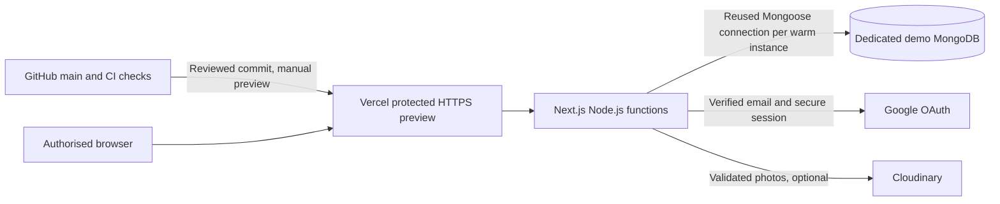

# Temporary Vercel hosting

TrustNest is prepared for an access-controlled Vercel Hobby preview for non-commercial NCI coursework. Vercel Hobby costs €0 within the included limits. Select a free database and optional storage plan separately, keep usage within their limits and leave optional paid maps disabled unless a suitable restricted account is available.

## Account linking and protected preview

1. Sign in to your personal Vercel Hobby account with `npx vercel login`. Use `npx vercel project add` to create an empty project. Set Next.js, Node.js 24.x and the repository root. Use `npx vercel link` to link this checkout to the empty project.
2. Before creating the preview, enable **Vercel Authentication** with **Standard Protection**. Use the dashboard to verify the protection scope. Then grant the Vercel GitHub integration access to **sumitbolla7/TrustNest** only and run `npx vercel git connect`. The checked-in `vercel.json` disables automatic Git deployments on all branches. On Hobby, production domains are outside Standard Protection, so leave production promotion and production aliases disabled.
3. Begin with the provider-free preview to validate the build, search and sample pages. For a database-backed preview, use a dedicated `trustnest_demo` database and a separate least-privilege database user. Enter `MONGODB_URI`, `NEXTAUTH_SECRET`, `GOOGLE_CLIENT_ID` and `GOOGLE_CLIENT_SECRET` in the **Preview** environment. Use the same stable protected HTTPS origin in `NEXTAUTH_URL` and `NEXT_PUBLIC_DOMAIN`. Register the exact `https://YOUR-PREVIEW-ORIGIN/api/auth/callback/google` with Google. Leave `NEXTAUTH_URL_INTERNAL` blank unless an internal URL is required. Omit map and Cloudinary credentials for an upload-free preview.
4. If using MongoDB Atlas, configure a network route that meets your access policy. A preview can run with fictional in-memory listings while that connection is pending. Keep seeding credentials on your machine, separate from Vercel runtime credentials. Never reuse production data.
5. After GitHub application checks, Semgrep and Gitleaks pass and findings have been reviewed, run `npx vercel deploy` from the reviewed Git checkout to create a preview. Avoid `--prod` or production promotion until the maintainer separately approves public access. Confirm in a signed-out browser that the preview prompts for Vercel Authentication. Check HTTPS cookies, Google sign-in and private endpoints with two synthetic accounts on the protected URL before sharing it with authorised reviewers.

Vercel names are assigned during setup. Suggestions include `trustnest-ie`, `trustnest-nci` and `trustnest-demo`.

## Changes and rollback

Keep automatic deployments disabled for the academic preview. Create a fresh protected preview for a reviewed branch or commit when it needs assessment. Redeploy the last known-good commit with the same protected settings if a change regresses. Verify the protection scope and the configured callback URL again. Hobby production rollback applies only to the immediately previous eligible production deployment. A protected preview can be recreated from its commit.

The CLI upload excludes local test data, environment files and archived reference media through `.vercelignore`. Use one preview for each review milestone, limit image sizes and traffic, and check the Hobby usage dashboard. Remove obsolete preview aliases when they are no longer needed. MongoDB counters enforce authenticated write limits across function instances. Anonymous traffic still needs monitoring and a hosting-side policy before public use. The app caps listing form requests at 4 MB and re-encodes accepted images. Cloudinary cleanup on failed creation is best effort.

- [Vercel CLI project creation](https://vercel.com/docs/cli/project)
- [Vercel Hobby terms and limits](https://vercel.com/docs/plans/hobby)
- [Vercel Deployment Protection](https://vercel.com/docs/deployment-protection)
- [Vercel Git configuration](https://vercel.com/docs/project-configuration/git-configuration)
- [Vercel Instant Rollback](https://vercel.com/docs/instant-rollback)
